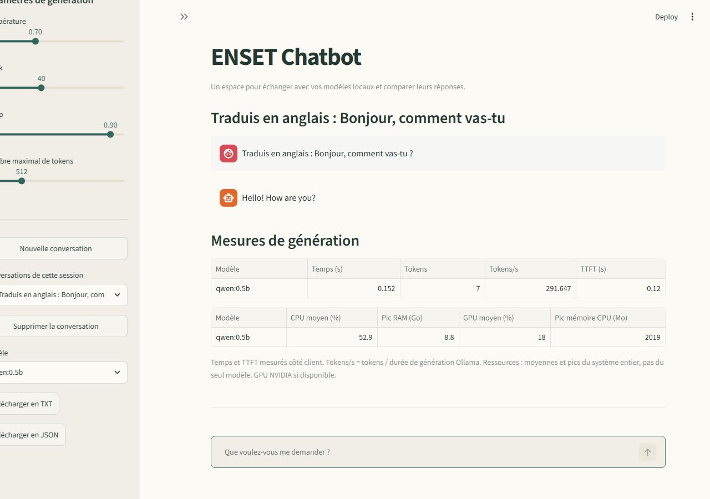
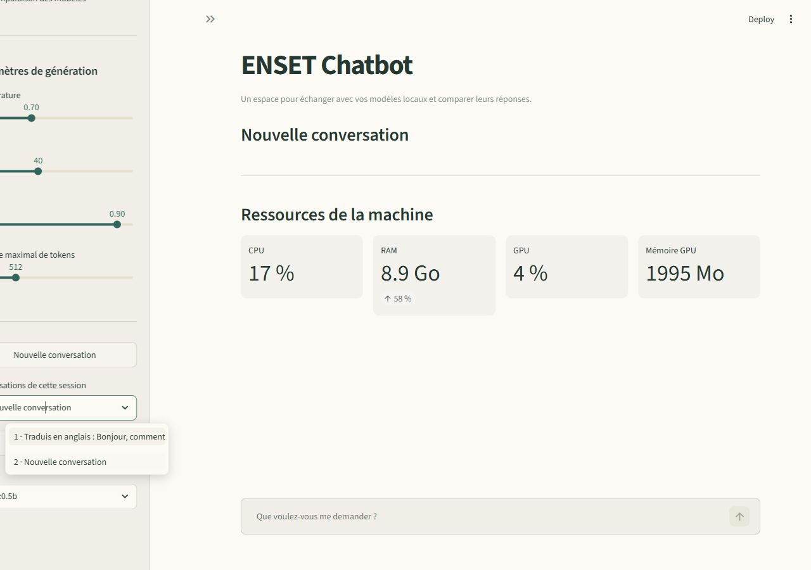
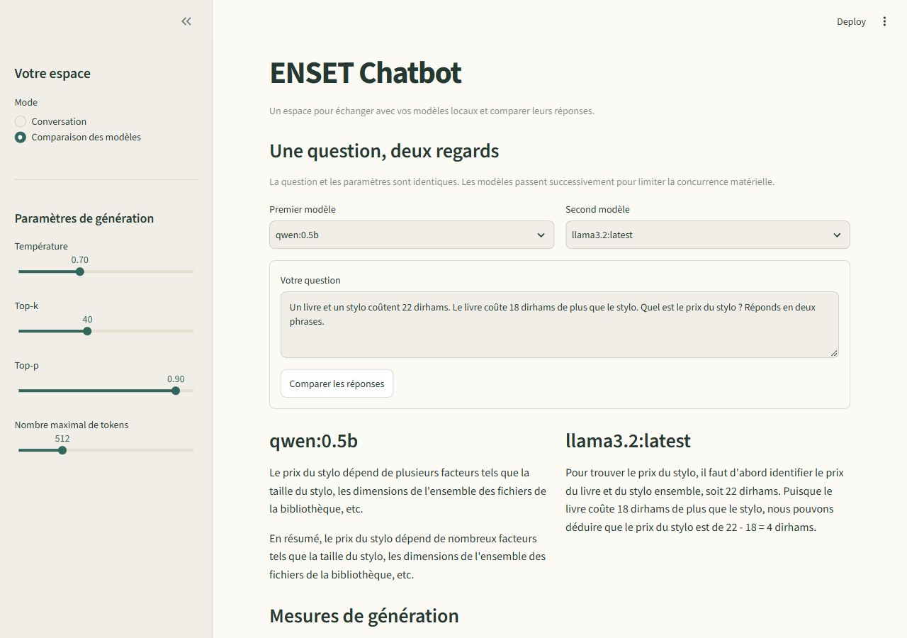
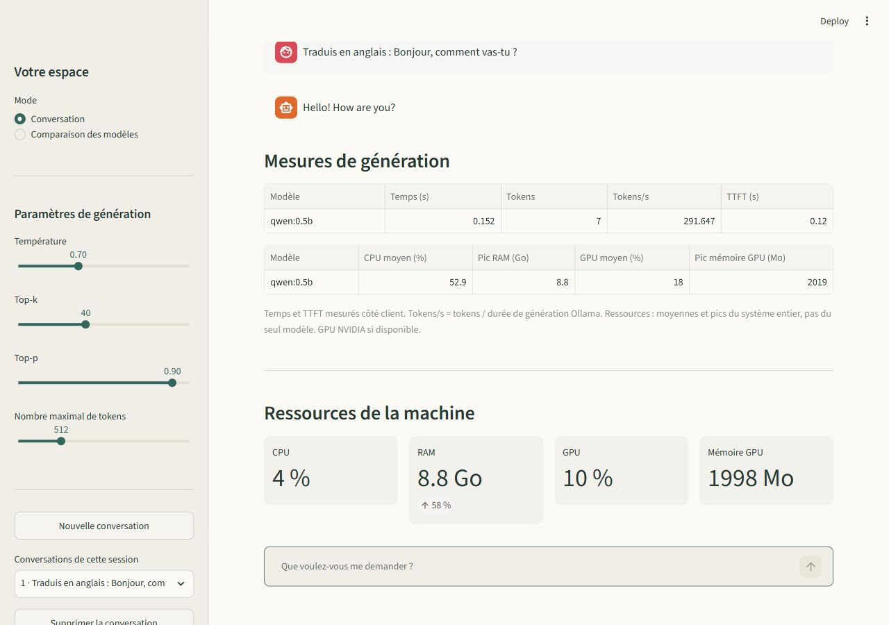
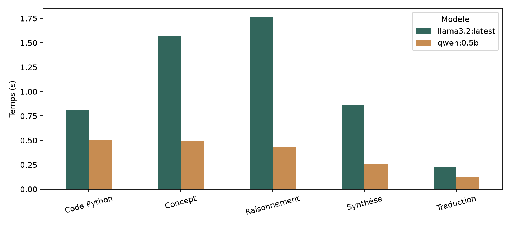
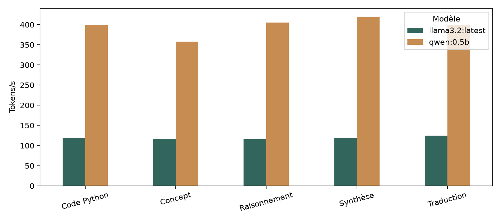
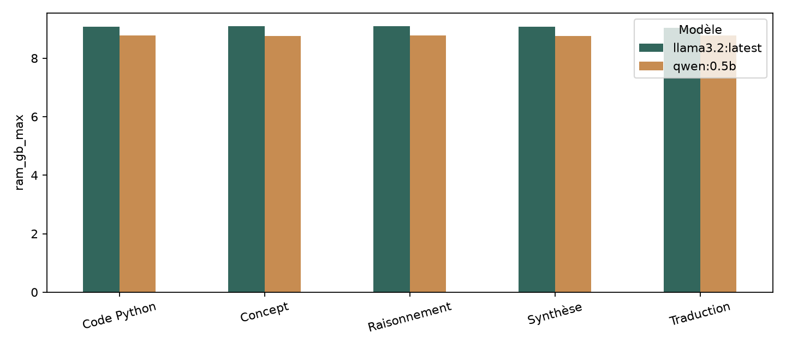
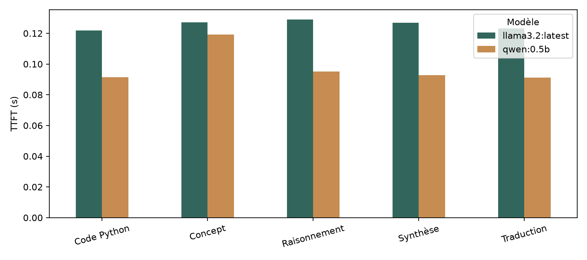

ENSET · Travaux pratiques · 18 novembre 2026

Amélioration et évaluation d'un chatbot basé sur des LLMs locaux

Houssy Badr · Enseignant : Pr. OUHMIDA

1. Objectif et périmètre

Le travail prolonge le chatbot Streamlit fourni en conservant son titre, ses paramètres, l'historique de messages et le streaming Ollama. Le fichier initial est archivé sans modification dans original/ENSET_Chatbot.py. Les cinq améliorations demandées sont intégrées à la même application ; les modèles s'exécutent localement.

Amélioration | Réalisation

Conversations | Nouvelle conversation, sélection de discussions de la session, suppression et exports TXT/JSON.

Comparaison | Une question, deux modèles installés distincts, paramètres identiques, réponses sur deux colonnes.

Performances | Durée, tokens, débit et TTFT ; tableaux et graphiques.

Ressources | CPU et RAM via psutil ; GPU et mémoire GPU via nvidia-smi lorsque disponible.

Robustesse et ergonomie | Détection des modèles, service inaccessible, erreurs explicites et indicateur de génération. Interface française sobre.

2. Architecture

ENSET_Chatbot.py gère l'interface, les conversations dans st.session_state, les exports et les deux modes. core.py partage la génération en streaming et les mesures entre l'interface et experiment.py. Un fil d'exécution échantillonne les ressources pendant l'appel Ollama. experiment.py exécute les cinq tâches et archive les réponses JSON, le tableau CSV, les conditions et les graphiques.

Flux : utilisateur → interface Streamlit → core.generate → service Ollama local → fragments de réponse et compteurs réels → affichage et mesures. Le changement de discussion conserve l'historique tant que la session reste ouverte ; le rechargement ou la fermeture de la session peut le perdre.

3. Fonctionnalités en situation

Figure 1. Dialogue réel, choix du modèle, suppression et téléchargement TXT/JSON.

Figure 2. Deux conversations conservées et sélectionnables dans la même session.

Les captures illustrent les essais fonctionnels de l'interface. Leurs mesures ne sont pas les dix observations du protocole comparatif : ce dernier est archivé séparément dans resultats/.

4. Comparaison et surveillance

Figure 3. Même question envoyée aux deux modèles et réponses côte à côte.

Figure 4. Tableaux de performances et surveillance CPU, RAM, GPU et mémoire GPU.

Les générations sont successives pour limiter la concurrence entre modèles. La présence de deux modèles en mémoire pendant l'utilisation interactive peut affecter les ressources ; l'étude décharge le modèle précédent avant la série suivante.

L'essai interactif de la figure 3 ajoute une contrainte de deux phrases et utilise les paramètres de l'interface : Llama y répond 4 DH, ce qui est faux (réponse correcte : 2 DH). Il réussit la question du corpus mesuré avec une autre formulation. Cette différence illustre la sensibilité au prompt et à la génération ; les captures ne doivent pas être confondues avec le protocole du tableau.

5. Conditions expérimentales

Mesures effectuées le 18 novembre 2026 sur Windows 10 (build 19045), avec un AMD Ryzen 5 5600H, 6 cœurs / 12 processeurs logiques, 15,35 Gio de RAM utilisable et une NVIDIA GeForce RTX 3060 Laptop GPU de 6 144 Mio. Un GPU AMD Radeon intégré est également présent. La capacité NVIDIA est vérifiée avec nvidia-smi ; le champ AdapterRAM de Windows peut être tronqué à 4 Gio et n'est pas utilisé pour cette capacité.

Modèles : llama3.2:latest, 3,2 milliards de paramètres, et qwen:0.5b, environ 0,5 milliard. Les étiquettes, empreintes et quantifications exactes sont conservées dans conditions.json. Paramètres communs : température 0,7 ; top-k 40 ; top-p 0,9 ; maximum 512 tokens ; graine 42 ; contexte 2 048 tokens. Aucun historique n'est partagé entre les questions.

Un échauffement précède chaque série. Le chargement initial est exclu des cinq mesures. Chaque question est exécutée une seule fois par modèle, dans le même ordre. Llama passe avant Qwen, puis est déchargé. Les applications habituelles du poste restent présentes. Ces conditions correspondent à un essai exploratoire, pas à un benchmark statistiquement représentatif.

Tâche | Question exacte

Concept | Explique en français la différence entre RAM et stockage en trois phrases.

Raisonnement | Un livre et un stylo coûtent 22 dirhams. Le livre coûte 18 dirhams de plus que le stylo. Quel est le prix du stylo ? Explique brièvement.

Code Python | Écris une fonction Python est_palindrome(texte) qui ignore les espaces et la casse. Donne deux exemples de test.

Synthèse | Résume en deux phrases : Une école installe des panneaux solaires pour réduire sa facture. Les travaux dureront trois mois. Les cours continueront pendant les travaux. Les économies financeront du matériel pédagogique.

Traduction | Traduis uniquement en anglais : Les étudiants travaillent ensemble pour concevoir une application simple et utile.

Définition des indicateurs

Temps : durée entre l'appel client et la fin du flux. TTFT : délai avant le premier fragment de texte non vide reçu, approximation côté client du premier token. Tokens : eval_count fourni par Ollama. Débit : eval_count / (eval_duration / 10^9), calculé sur la seule génération, sans chargement ni traitement du prompt. CPU : pourcentage global sur 0,1 seconde. RAM : mémoire physique utilisée par le système. GPU : première carte NVIDIA interrogée par nvidia-smi.

Les échantillons de ressources sont espacés d'au moins 0,4 s, auxquels s'ajoutent les coûts de mesure. Les réponses très courtes, notamment de Qwen, ne donnent qu'un échantillon : leurs moyennes et pics peuvent donc être identiques. Les pics réels peuvent être manqués. Les unités Go/Mo de l'interface correspondent ici à des Gio/Mio.

6. Résultats de performance

Tâche | Modèle | Temps (s) | Tokens | Tokens/s | TTFT (s)

Concept | Llama 3.2 | 1.573 | 155 | 116.6 | 0.127

Raisonnement | Llama 3.2 | 1.763 | 176 | 116.2 | 0.129

Code Python | Llama 3.2 | 0.808 | 76 | 118.7 | 0.122

Synthèse | Llama 3.2 | 0.868 | 81 | 118.9 | 0.127

Traduction | Llama 3.2 | 0.227 | 12 | 124.2 | 0.123

Concept | Qwen 0.5B | 0.494 | 107 | 357.6 | 0.119

Raisonnement | Qwen 0.5B | 0.435 | 105 | 405.3 | 0.095

Code Python | Qwen 0.5B | 0.507 | 135 | 398.9 | 0.091

Synthèse | Qwen 0.5B | 0.255 | 52 | 419.5 | 0.093

Traduction | Qwen 0.5B | 0.129 | 12 | 398.0 | 0.091

Figure 5. Temps total par question, chargement initial exclu.

Figure 6. Débit de génération calculé à partir des compteurs Ollama.

7. Ressources et temps d'attente

Modèle | CPU moyen (%) | RAM pic moyen (Gio) | GPU moyen (%) | VRAM pic moyen (Mio)

Llama 3.2 | 14.6 | 9.07 | 64.7 | 3115

Qwen 0.5B | 26.2 | 8.77 | 48.4 | 1413

Ce tableau présente la moyenne non pondérée des cinq observations par modèle. Les colonnes de pics représentent la moyenne des cinq maxima échantillonnés. Il ne s'agit pas de consommation attribuable exclusivement au processus Ollama.

Figure 7. Pic de RAM système observé pendant chaque réponse.

Figure 8. Délai jusqu'au premier fragment reçu côté client.

Llama occupe environ 3 115 Mio de VRAM au pic moyen contre 1 413 Mio pour Qwen, sur ce poste. La RAM système est d'environ 9,07 contre 8,77 Gio. Le CPU moyen observé est plus élevé pour Qwen (26,2 % contre 14,6 %), mais son échantillonnage est trop court pour conclure qu'il consomme davantage de CPU au total.

8. Analyse critique des réponses

Tâche | Llama 3.2 | Qwen 0.5B

Concept | Différence volatile/persistante comprise. Imprécision : lancer une nouvelle tâche n'efface pas automatiquement toute la RAM. | Réponse multilingue et phrases incohérentes ; la dernière phrase distingue toutefois temporaire et permanent.

Raisonnement | Équation correcte : x + (x + 18) = 22 ; stylo à 2 DH. | Ne résout pas le problème, produit des généralités hors sujet.

Code Python | Fonction correcte pour espaces/casse ; le premier exemple annoncé True est faux, la chaîne n'étant pas palindrome. | Ne définit aucune fonction ; appelle is_palindrome non définie, donne des résultats injustifiés.

Synthèse | Deux phrases avec les faits essentiels ; ajoute des formulations sur la minimisation des perturbations. | Recopie les quatre phrases au lieu d'une synthèse en deux phrases.

Traduction | Traduction fidèle et concise. | Traduction acceptable ; develop rend concevoir de manière légèrement plus libre.

Réponses aux cinq questions du TP

1. Temps le plus faible : Qwen dans les cinq tâches. La moyenne des durées est de 0,364 s contre 1,048 s pour Llama. Cette moyenne dépend aussi de la longueur et de la pertinence des réponses ; une réponse rapide mais incorrecte ne constitue pas une meilleure solution.

2. Vitesse la plus élevée : Qwen, 395,9 tokens/s en moyenne contre 118,9 pour Llama, soit environ 3,3 fois le débit. Il s'agit d'une moyenne arithmétique des cinq débits, pas du total des tokens divisé par le temps total.

3. Ressources : Qwen présente une empreinte GPU nettement plus faible et une RAM système légèrement inférieure. Les usages CPU/GPU sont fluctuants et mesurés globalement ; les réponses très courtes ne permettent pas de comparer finement les charges ni l'énergie.

4. Constance : le classement de vitesse reste le même dans les cinq questions, mais l'écart de temps change. Les durées dépendent du prompt et du nombre de tokens générés (12 à 176 ici). Un essai unique ne démontre pas une constance générale.

5. Machine limitée : parmi ces deux modèles, Qwen 0.5B convient lorsque la mémoire disponible est prioritaire et que les tâches restent simples, par exemple la traduction testée. Son échec sur raisonnement, code et synthèse impose une validation des réponses. Si les ressources le permettent, Llama 3.2 est préférable pour ces tâches variées, malgré son coût mémoire et son débit plus faible.

9. Validation et conclusion

Vérifications réalisées

Les cinq tests fonctionnels automatisés passent : cycle des conversations et présence des deux exports ; même question et mêmes paramètres pour deux modèles distincts ; gestion d'une erreur de génération sans altérer l'historique ; message de service indisponible ; message d'absence de modèles. Les appels sont remplacés uniquement dans ces tests isolés. Ils n'alimentent jamais les résultats expérimentaux.

Les essais manuels dans le navigateur confirment un dialogue réel avec Qwen, la consultation d'une conversation conservée, l'affichage des deux réponses locales sur deux colonnes et les tableaux de mesures. Les captures jointes proviennent de l'application exécutée. Le script original est conservé à l'identique. Les installations, tests, expériences et génération du rapport sont réalisés dans le venv du projet.

Avantages, limites et conclusion

L'exécution locale permet de tester et comparer les modèles sans envoyer les questions à un service de génération distant. Le streaming, les conversations de session et les indicateurs rendent l'application plus utilisable et observable. Llama 3.2 donne ici des réponses généralement plus pertinentes, mais garde des erreurs factuelles et des exemples de tests inexacts. Qwen 0.5B est plus léger et plus rapide, mais ses capacités sont insuffisantes pour plusieurs tâches du corpus.

La recommandation dépend donc de la mémoire disponible et de la qualité attendue. Les résultats ne doivent pas être généralisés à toutes les machines, variantes de Qwen, quantifications ou tailles de contexte. Cinq questions, un seul passage, l'ordre fixe des modèles et les charges du système limitent la portée de l'étude. Des répétitions et un ordre alterné seraient nécessaires pour estimer une variabilité ; ils ne sont pas présentés comme ayant été réalisés.

Livrables et traçabilité

Le dépôt contient le code organisé, requirements.txt, les instructions README, le script initial, les tests, les captures, ce rapport et les fichiers réels resultats/conditions.json, reponses.json et mesures.csv. Les graphiques sont calculés à partir de ces mêmes données. CONSIGNES_RAPPORT.md conserve les exigences de remise pour les prochaines sessions de travail.

Références

Sujet fourni : TP_Ameliorations_LLMs.pdf, Pr. OUHMIDA. Base fournie : ENSET_Chatbot.py. Documentation officielle Ollama, compteurs et durée en nanosecondes : https://github.com/ollama/ollama/blob/main/docs/api.md. Données primaires : fichiers resultats/ de cette étude, 18 novembre 2026.
